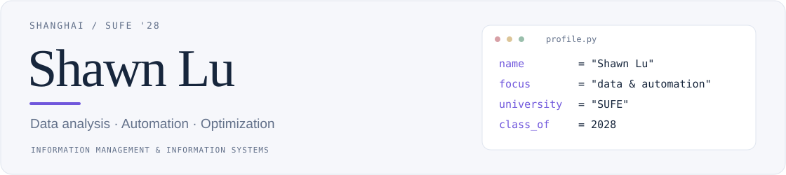
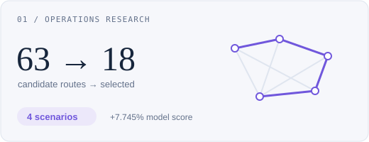
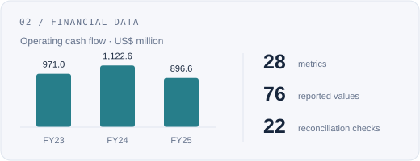

<picture>
  <source media="(prefers-color-scheme: dark)" srcset="assets/hero-dark.svg">
  
</picture>

<samp><a href="#about">About</a> · <a href="#selected-projects">Projects</a> · <a href="#toolbox">Toolbox</a> · <a href="mailto:x29981412@gmail.com">Contact</a> · <a href="https://github.com/x29981412-maker/x29981412-maker#readme">中文</a></samp>

## About

I'm **Shawn Lu (路顺翔)**, an Information Management and Information Systems undergraduate at **Shanghai University of Finance and Economics**, Class of 2028.

I work with **Python, SQL and Oracle**, focusing on data preparation, validation, reporting automation and modeling. Below are two projects covering operations research and financial data analysis.

## Selected projects

<table><tr>
<td width="50%" valign="top">
<a href="https://github.com/x29981412-maker/xinjiang-tourism-optimization"><picture>
  <source media="(prefers-color-scheme: dark)" srcset="assets/project-routes-dark.svg">
  
</picture></a>
<h3><a href="https://github.com/x29981412-maker/xinjiang-tourism-optimization">Xinjiang Tourism Route Optimization</a></h3>

A team study of four travel scenarios, balancing destination coverage, transport costs and travel schedules.

<strong>Methods</strong> Multimodal networks, route optimization, mixed-integer programming and scenario simulation.

<strong>Team result</strong> 18 of 63 routes selected; a 7.745% increase in the model score under fixed assumptions.

<a href="https://github.com/x29981412-maker/xinjiang-tourism-optimization">Repository ↗</a> · <a href="https://github.com/x29981412-maker/xinjiang-tourism-optimization/blob/main/paper/main.pdf">Report ↗</a>

</td>
<td width="50%" valign="top">
<a href="https://github.com/x29981412-maker/education-financial-analysis"><picture>
  <source media="(prefers-color-scheme: dark)" srcset="assets/project-finance-dark.svg">
  
</picture></a>
<h3><a href="https://github.com/x29981412-maker/education-financial-analysis">Financial Data Validation & Cash Flow Analysis</a></h3>

A three-person study of New Oriental’s public disclosures for FY2023–2025. I handled data preparation and analysis.

<strong>My contribution</strong> Compiled 76 reported values across 28 metrics; preserved source references and aligned data definitions.

<strong>Analysis</strong> Implemented 22 reconciliation checks in Python and examined operating cash flow movements.

<a href="https://github.com/x29981412-maker/education-financial-analysis">Repository ↗</a> · <a href="https://github.com/x29981412-maker/education-financial-analysis/blob/main/paper/main.pdf">Report ↗</a>

</td>
</tr></table>

## Toolbox

<table><tr><td width="33%" valign="top"><strong>Analysis</strong>
<code>Python</code> <code>pandas</code>

Cleaning & validation Statistics & visualization Automation scripts
</td><td width="33%" valign="top"><strong>Databases</strong>
<code>SQL</code> <code>Oracle</code>

Joins & aggregations Window functions Data reconciliation
</td><td width="33%" valign="top"><strong>Reporting</strong>
<code>Excel</code> <code>Word</code>

PivotTables & charts Research reports Document formatting
</td></tr></table>

---

Data, methods and reports are linked in each project. Happy to connect on analysis, automation and modeling.

<strong><a href="mailto:x29981412@gmail.com">x29981412@gmail.com</a></strong>

