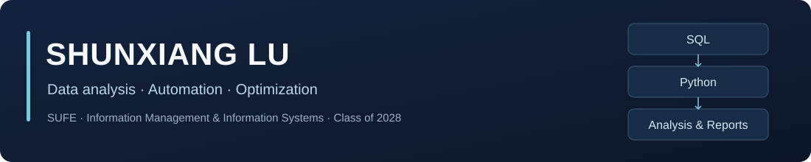

[English](https://github.com/x29981412-maker/x29981412-maker/blob/main/README.en.md) · [联系我](mailto:x29981412@gmail.com)

我是**路顺翔 / Shunxiang Lu**，上海财经大学信息管理与信息系统专业本科生，2028届。

主要关注数据分析、信息系统与流程自动化。这里整理我的研究项目，展示数据来源、分析方法、代码和报告。

### 技术方向

| 方向 | 工具与工作内容 |
| --- | --- |
| 数据分析与自动化 | Python、pandas；数据清洗、统计分析、结果核验与自动化脚本 |
| 数据库 | Oracle、SQL；多表关联、聚合查询、窗口函数与数据核对 |
| 报表与研究 | Excel、Word；数据汇总、可视化、研究报告与规范排版 |

### 代表项目

#### [新疆旅游线路多场景优化](https://github.com/x29981412-maker/xinjiang-tourism-optimization)

参与团队数学建模研究，围绕个人旅行、两年分期旅行、文化考察和节假日接待四类场景，比较景点覆盖、交通成本与行程安排。

- **研究方法：** 多模式交通网络、路径优化、调度、混合整数规划与情景仿真。
- **团队结果：** 在固定假设下，从63条候选线路中选取18条，模型综合评分提升7.745%。

[研究报告](https://github.com/x29981412-maker/xinjiang-tourism-optimization/blob/main/paper/main.pdf) · [模型与结果说明](https://github.com/x29981412-maker/xinjiang-tourism-optimization#readme)

#### [教育企业财务数据核验与现金流分析](https://github.com/x29981412-maker/education-financial-analysis)

以新东方2023—2025财年公开年报数据为例，研究财务报表勾稽关系，以及利润与经营现金流的变化。我在三人小组中负责数据整理与分析。

- **个人工作：** 整理28个指标、76个披露值，保留原始科目与页码，统一财年、币种和合并口径。
- **计算分析：** 使用Python完成22项基本勾稽检查，分析递延收入等调整对经营现金流变动的影响。

[研究报告](https://github.com/x29981412-maker/education-financial-analysis/blob/main/paper/main.pdf) · [数据与分析](https://github.com/x29981412-maker/education-financial-analysis#readme)

### 联系

欢迎交流数据分析、自动化和数学建模项目。

**Email:** [x29981412@gmail.com](mailto:x29981412@gmail.com)
